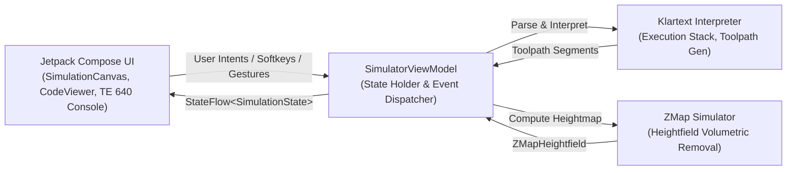
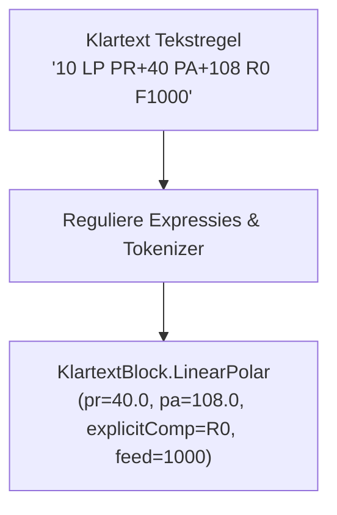
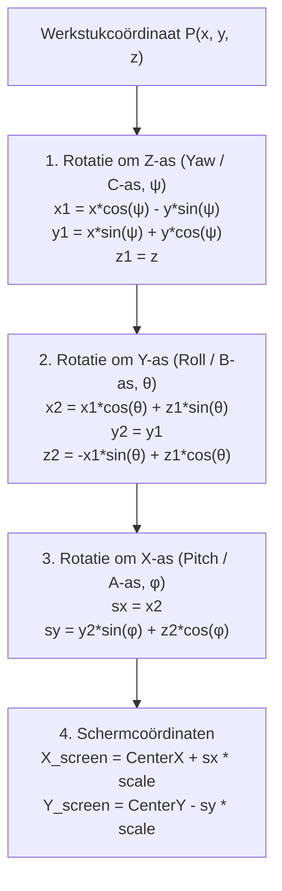
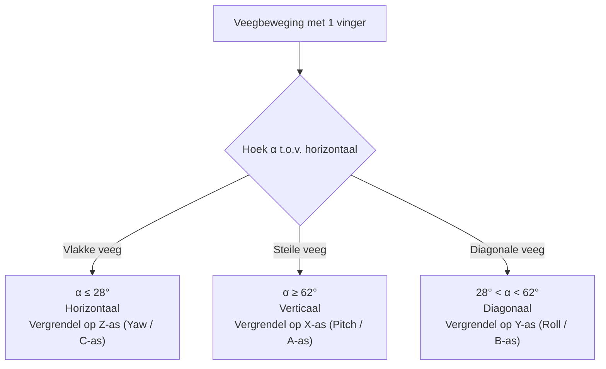

# Technische Architectuur & Systeemdocumentatie

Dit document beschrijft de interne software-architectuur, wiskundige rekenmodellen en rendering-pipelines van de **Heidenhain Klartext CNC Simulator**.

---

## Inhoudsopgave
1. [Overzicht & MVI-Architectuur](#1-overzicht--mvi-architectuur)
2. [Klartext Parser & AST Pipeline](#2-klartext-parser--ast-pipeline)
3. [CNC Interpreter & Baanberekening](#3-cnc-interpreter--baanberekening)
4. [3D Orbit Projectie- & Render-Engine](#4-3d-orbit-projectie--render-engine)
5. [Aanraakbediening & As-Vergrendeling](#5-aanraakbediening--as-vergrendeling)
6. [2.5D Volumetrische Verspanings-Engine](#6-25d-volumetrische-verspanings-engine)
7. [TE 640 Console & Dual UI Theming](#7-te-640-console--dual-ui-theming)
8. [CAD / CAM / ISO Integratie](#8-cad--cam--iso-integratie)

---

## 1. Overzicht & MVI-Architectuur

De applicatie is gebouwd in **Kotlin** met **Jetpack Compose** volgens het **MVI (Model-View-Intent)** ontwerppatroon. Dit waarborgt een strikt eenrichtingsverkeer van data (Unidirectional Data Flow):



### Belangrijkste Componenten:
- **`SimulationState`**: Onveranderlijke dataclass die de complete toestand representeert (huidige blok, actuele $X, Y, Z$ coördinaten, actieve voeding $F$, spiltoerental $S$, actieve gereedschap $T$, lijst met berekende `ToolpathSegment`s, diagnostische meldingen en console-thema).
- **`SimulatorViewModel`**: Beheert het simulatieproces, time-stepping coroutines, play/pause logica en wisselwerking tussen de parser, de interpreter en de UI.
- **`SimulatorScreen`**: Root composable die schakelt tussen telefoons (single-pane / landscape) en tablets/desktops (twin-screen console mode).

---

## 2. Klartext Parser & AST Pipeline

De broncode in Klartext (`.H`) wordt via `KlartextParser.kt` omgezet in een getypeerde **Abstract Syntax Tree (AST)** bestaande uit sealed classes van `KlartextBlock`.



### Ondersteunde AST Knooppunten (`KlartextBlock`):
- `BeginPgm` / `EndPgm`: Programmagrenzen met eenheidsvalidatie (`MM` of `INCH`).
- `BlkForm`: Ruwdeeldefinitie (min/max hoekpunten).
- `ToolDef` / `ToolCall`: Gereedschapsoproep met spilas, $S$, $F$, $DL$ en $DR$.
- `Linear`: Cartesiaanse lineaire verplaatsing (`L`) met radiuscompensatie (`RL`/`RR`/`R0`), ijlgang (`FMAX`), en incrementele assen (`IX`, `IY`, `IZ`).
- `LinearPolar`: Polaire lineaire verplaatsing (`LP`) met poolstraal `PR`, poolhoek `PA` of incrementele hoek `IPA`.
- `CircleCenter`: Definitie van cirkelmiddelpunt of pool (`CC`).
- `Circle`, `CircleRadius`, `CircleTangential`, `CirclePolar`: Cirkelboogbewegingen (`C`, `CR`, `CT`, `CP`).
- `CornerRounding` (`RND`) en `CornerChamfer` (`CHF`): Vloeiende overgangsfuncties.
- `Approach` (`APPR`) en `Depart` (`DEP`): Zachte contourbenadering en verlating (`LT`, `LN`, `CT`, `LCT`).
- `LabelSet` (`LBL SET`), `LabelCall` (`CALL LBL`): Subprogramma's en herhalingen (`REP`).
- `CycleDef` (`CYCL DEF`) en `CycleCall` (`CYCL CALL`): Vaste bewerkingscycli.
- `QParamDef`, `QParamAssignment`, `QParamConditionalJump`: Variabelen en rekenkundige functies (`FN 0..12`).

---

## 3. CNC Interpreter & Baanberekening

In `KlartextInterpreter.kt` worden de AST-blokken chronologisch geëvalueerd.

### 3.1 Call Stack & Repetition Handling
Subprogramma's en herhalingen worden bijgehouden via een interne call stack:
```kotlin
private data class CallFrame(
    val returnPc: Int,
    val labelNumber: Int,
    val remainingRepeats: Int
)
```
- Bij `CALL LBL [nr]` wordt de huidige programmateller `pc` gepusht en springt de interpreter naar `LBL nr`.
- Bij `LBL 0` popt de interpreter het frame en hervat op `returnPc`.
- Bij `CALL LBL [nr] REP [n]` houdt een herhalingsteller `sectionRepeatCounters` het resterende aantal cycli bij.
- Bij het bereiken van `M30` of `M02` in het hoofdprogramma stopt de interpreter onmiddellijk, waardoor ongewenste doorloop in subprogramma's wordt voorkomen.

### 3.2 Radiuscompensatie Meetkunde ($RL$ / $RR$)
Wanneer het gereedschap langs een contour beweegt met $RL$ (links) of $RR$ (rechts), berekent de interpreter de genormaliseerde richtingvector $\vec{v} = (v_x, v_y)$:
$$\hat{v} = \frac{(x_2 - x_1, y_2 - y_1)}{\sqrt{(x_2 - x_1)^2 + (y_2 - y_1)^2}}$$

De loodrechte normaalvector $\vec{n}$ wordt bepaald door:
$$\vec{n}_{RL} = (-v_y, v_x), \quad \vec{n}_{RR} = (v_y, -v_x)$$

Het werkelijke freesmiddelpunt $P_{frees}$ wordt verschoven over de effectieve gereedschapsradius $R_{eff} = R + DR$:
$$P_{frees} = P_{geprogrammeerd} + \vec{n} \cdot R_{eff}$$

Bij `APPR LT` (tangentieel aanrijden met lengte $\text{LEN}$) berekent de simulator het startpunt buiten het werkstuk:
$$P_H = P_A - \hat{v}_{\text{contour}} \cdot \text{LEN}$$
Tussen $P_H$ en $P_A$ vindt een vloeiende overgang plaats van ongecorrigeerd ($R0$) naar gecompenseerd ($RL$).

---

## 4. 3D Orbit Projectie- & Render-Engine

De visualisatie maakt gebruik van een custom 3D software rendering engine op het Jetpack Compose `Canvas`.

### 4.1 Euler Hoektransformaties (Yaw, Pitch, Roll)
Voor een willekeurig punt $P(x, y, z)$ in het werkstukcoördinatensysteem verloopt de projectie als volgt:



> [!IMPORTANT]
> **Correcte Assen-Oriëntatie**:
> In computerafbeeldingen wijst de scherm-Y-as naar beneden. Om de CNC-standaard te respecteren waarbij $+Z$ naar boven wijst (gereedschap steekt in naar beneden, machineklem zit eronder), wordt $Y_{screen} = \text{Center.y} - s_y \cdot \text{scale}$ toegepast, met $s_y = y_2 \sin(\phi) + z_2 \cos(\phi)$.

### 4.2 Machine-omgeving Rendering
- **Machineklem (Vise)**: Automatisch gepositioneerd onder het ruwdeel ($Z \le Z_{min}$) met stalen klembekken, spindel en grondplaat.
- **Assenkruis (Gizmo)**: Kleurgecodeerde assen volgens industriële CAD/CAM standaard:
  - 🔴 **Rood**: $+X$ as
  - 🟢 **Groen**: $+Y$ as
  - 🔵 **Blauw**: $+Z$ as (loodrecht omhoog)
- **Gereedschapsweergave**: 3D wireframe freeslichaam met snijkanten en oranje gereedschapshouder.

---

## 5. Aanraakbediening & As-Vergrendeling

Touchscreenbediening op telefoons en tablets verschilt fundamenteel van muisbesturing op een pc. Zonder vergrendeling leidt een diagonale veeg tot ongecontroleerd zwabberen over meerdere assen tegelijk.

### 5.1 Directional Angle Locking (1 Vinger)
Tijdens een veegbeweging met één vinger berekent de simulator in real-time de bewegingshoek $\alpha$:
$$\alpha = \arctan\left(\frac{|\Delta y|}{|\Delta x|}\right)$$



Zodra de drempelwaarde ($10\text{ px}$) wordt overschreden, wordt de rotatie vastgezet op **exact één as**. Dit garandeert stabiele inspectie van werkstukken.

### 5.2 Multi-Touch Gebaren (2 Vingers)
- **Knijpen (Pinch)**: Traploze zoom van $0.4\times$ tot $25\times$.
- **Slepen (Pan)**: Verplaatsen van het werkstuk over het scherm ($X/Y$ verschuiving).
- **Draaien (Twist)**: Vrije hoekverdraaiing om de gezichtsas.

---

## 6. 2.5D Volumetrische Verspanings-Engine

In `ZMapSimulator.kt` bevindt zich een hoogtemap-algoritme dat materiaalafname berekent met behoud van 60 FPS prestaties op mobiele apparaten.

### 6.1 Hoogtemap Discretisatie
Het ruwdeel wordt opgedeeld in een regelmatig grid van $\approx 100 \times 100$ cellen. Elke cel $(col, row)$ bewaart de actuele hoogte $Z$:
$$Z_{init}(col, row) = Z_{max}$$

### 6.2 Tool Stamping & Profielwiskunde
Voor elk freespadsegment stapt de simulator langs de baan en past per cel een gereedschapsprofiel toe:

1. **Vlakke Vingerfrees / Vlakfrees**:
   $$Z_{cut} = Z_{tip}$$
2. **Afschuinfrees $45^\circ$ / Centerboor $90^\circ$**:
   $$Z_{cut}(r) = Z_{tip} + r, \quad r = \sqrt{(x - x_c)^2 + (y - y_c)^2}$$
3. **Bolfrees (Ball Nose)**:
   $$Z_{cut}(r) = Z_{tip} + \left(R_{tool} - \sqrt{R_{tool}^2 - r^2}\right)$$
4. **Toruseindfrees (Torus / Bull-nose met hoekstraal $R_c$)**:
   $$Z_{cut}(r) = \begin{cases} Z_{tip} & \text{als } r \le (R_{tool} - R_c) \\ Z_{tip} + \left(R_c - \sqrt{R_c^2 - (r - (R_{tool} - R_c))^2}\right) & \text{als } r > (R_{tool} - R_c) \end{cases}$$

Als $Z_{cut} < Z_{huidig}(col, row)$, wordt de nieuwe diepte vastgelegd.

---

## 7. TE 640 Console & Dual UI Theming

De applicatie ondersteunt twee visuele consoles, configureerbaar via `ConsoleThemeColors.kt`:

1. **CLASSIC_TNC640 (Industrieel HEIDENHAIN TE 640)**:
   - Kastkleur in authentiek machinegrijs (RAL 7035: `#C7CED6`).
   - Ivoorwitte numerieke toetsen (`#F8FAFC`) met donkere opschriften.
   - Donker grafietkleurige contourtoetsen (`#1E2832`) met iconische oranje symbolen (`#FF9100`).
   - Blauwgrijze cyclusknoppen (`#243447`) met cyaankleurige opdruk.
   - Felle machinegroene `ENT` en `NC START` toetsen (`#15803D`).
   - Waarschuwingsrode `NO ENT` en `NC STOP` toetsen (`#B91C1C`).
   - Geborsteld aluminium draaiknoppen voor Feed- en Spindle-override ($0\% - 150\%$).
2. **HYPERMODERN (Sleek Cyber Cockpit)**:
   - Diepe leisteen- en koolstoftinten met gloeiende cyaan (`#00E5FF`) en neon oranje accenten.

---

## 8. CAD / CAM / ISO Integratie

### 8.1 DXF naar Klartext Converter (`DxfParser.kt`)
Importeert AutoCAD Release 12 tot 2018 DXF-tekeningen:
- Leest `LINE`, `ARC`, `CIRCLE` en `LWPOLYLINE` entiteiten.
- **Topologische Chaining**: Verbindt losse CAD-lijnstukken en bogen automatisch tot gesloten en open profielen op basis van eindpuntafstanden.
- Genereert direct een productierijp Klartext `.H` programma met `BLK FORM`, gereedschapsaanroep, veilige terugtrekhoogte en voedingssnelheden.

### 8.2 ISO G-Code Converter (`IsoGCodeConverter.kt`)
Biedt tweerichtingsconversie tussen standaard DIN 66025 / ISO 6983 G-code en HEIDENHAIN Klartext:
- `G00` $\leftrightarrow$ `L ... FMAX`
- `G01` $\leftrightarrow$ `L ... F...`
- `G02` / `G03` $\leftrightarrow$ `C ... DR-` / `C ... DR+`
- `G41` / `G42` / `G40` $\leftrightarrow$ `RL` / `RR` / `R0`
- `G81` / `G83` $\leftrightarrow$ `CYCL DEF 200`

### 8.3 Verspaningscalculator (`CuttingCalculatorDialog.kt`)
Berekent de snijtechnologische parameters:
- Snijsnelheid naar spiltoerental: $S = \frac{V_c \times 1000}{\pi \times D}$
- Voeding per tand naar tafelvoeding: $F = S \times z \times f_z$
- Tapvoeding (synchroon): $F = S \times P$
- Voorboor-diameter: $D_{boor} = D_{nom} - P$
